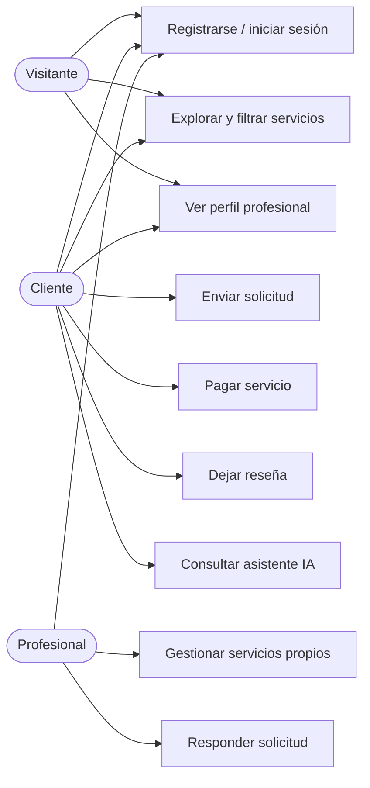
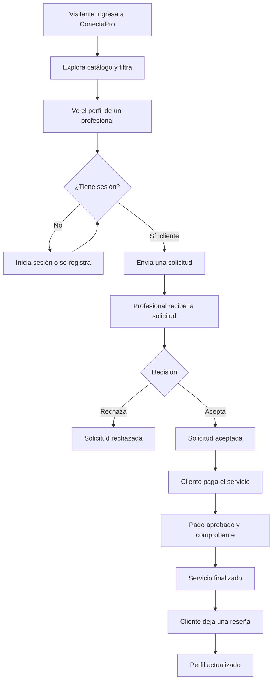
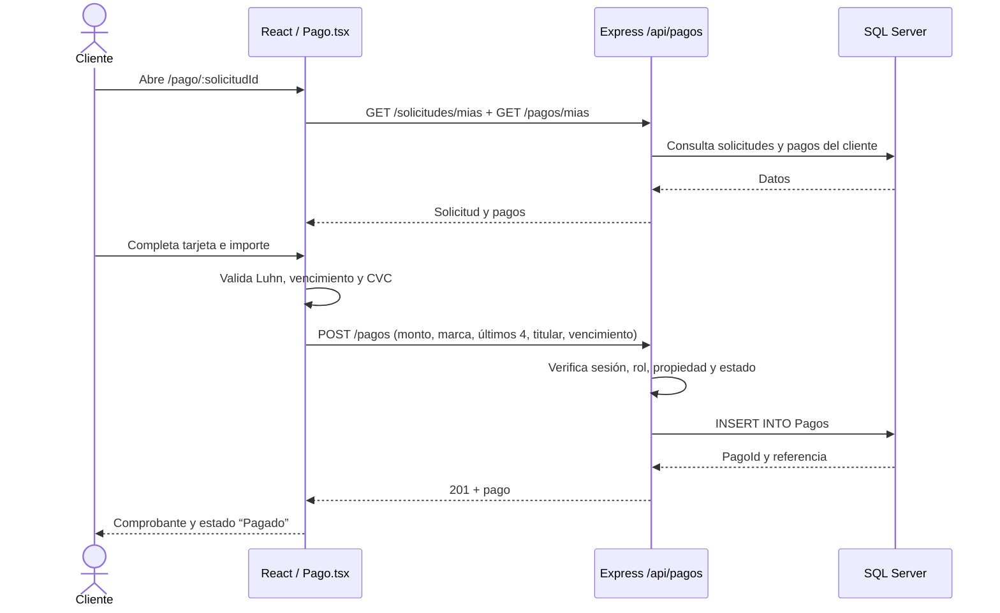
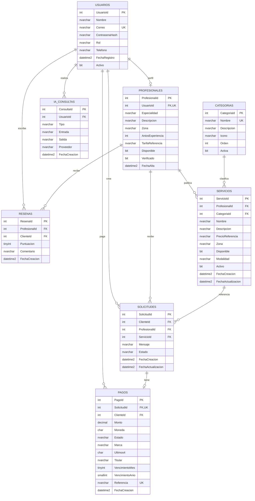
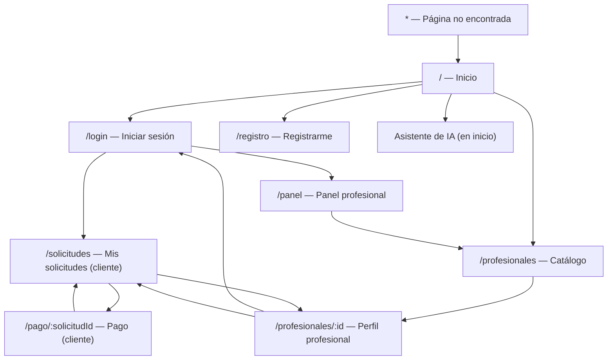
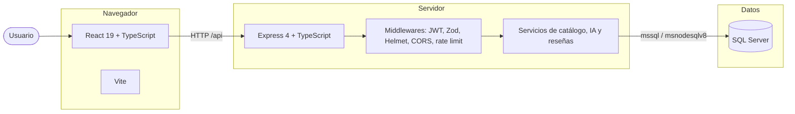

# Documentación de ConectaPro

**Proyecto:** ConectaPro — plataforma de conexión entre clientes y profesionales independientes  
**Stack:** React + TypeScript (Vite) · Node.js + TypeScript (Express) · SQL Server · JWT · Zod · `crd-ui`  
**Año:** 2026

---

## Índice

1. [Descripción general](#descripción-general)
2. [Objetivos y alcance](#objetivos-y-alcance)
3. [Actores y roles](#actores-y-roles)
4. [Casos de uso](#casos-de-uso)
5. [Flujo principal](#flujo-principal)
6. [Modelo de datos](#modelo-de-datos)
7. [Navegación de la aplicación](#navegación-de-la-aplicación)
8. [Arquitectura técnica](#arquitectura-técnica)
9. [API REST](#api-rest)
10. [Seguridad y autorización](#seguridad-y-autorización)
11. [Módulo de pagos con tarjeta](#módulo-de-pagos-con-tarjeta)
12. [Manual de usuario](#manual-de-usuario)
13. [Plan de pruebas funcionales](#plan-de-pruebas-funcionales)
14. [Registro de errores](#registro-de-errores)
15. [Organización del equipo](#organización-del-equipo)
16. [Criterios de cierre](#criterios-de-cierre)
17. [Anexos](#anexos)

---

## Descripción general

ConectaPro es una aplicación web full stack que permite a personas que necesitan un servicio encontrar profesionales independientes, consultar sus perfiles y publicaciones, enviar solicitudes, acordar un trabajo, pagar con tarjeta y dejar una reseña.

La plataforma cubre las siguientes categorías:

Electricidad, Plomería, Albañilería, Pintura, Informática, Cerrajería, Jardinería, Reparación de electrodomésticos y Nerd.

### Funcionalidades principales

- Registro e inicio de sesión con roles `cliente` y `profesional`.
- Catálogo de profesionales y servicios con búsqueda y filtros.
- Perfil público del profesional con reseñas y promedio de puntuación.
- Panel del profesional para crear, editar, pausar y eliminar sus publicaciones.
- Solicitudes de clientes a profesionales con estados `pendiente`, `aceptada`, `rechazada` y `finalizada`.
- Reseñas con puntuación de 1 a 5 y un comentario.
- Pago con tarjeta asociado a una solicitud aceptada o finalizada.
- Asistente de inteligencia artificial para sugerir categorías y mejorar descripciones.
- Persistencia real en SQL Server, validación con Zod y autorización en la API.

---

## Objetivos y alcance

### Objetivo general

Construir una plataforma funcional, segura y responsive que conecte clientes con profesionales de oficios, con persistencia real y permisos verificados en el servidor.

### Objetivos específicos

1. Permitir que un cliente encuentre un profesional adecuado según categoría, palabra clave, zona y disponibilidad.
2. Permitir que un profesional gestione únicamente sus propias publicaciones.
3. Registrar solicitudes, pagos y reseñas en SQL Server.
4. Aplicar autorización en la capa de API, dado que SQL Server no ofrece RLS equivalente a Supabase.
5. Incorporar al menos una funcionalidad de inteligencia artificial con respaldo local.
6. Documentar instalación, uso, pruebas y criterios de cierre.

### Fuera del alcance

- Cobro real con una pasarela de pagos. El módulo de tarjeta funciona en modo demostración.
- Mensajería en tiempo real entre cliente y profesional.
- Aplicación móvil nativa.
- Facturación electrónica o conciliación bancaria.
- Recuperación de contraseña por correo electrónico.

---

## Actores y roles

| Actor | Descripción | Permisos principales |
| --- | --- | --- |
| Visitante | Persona sin sesión | Explorar catálogo, ver perfiles, buscar y filtrar |
| Cliente | Usuario registrado con rol `cliente` | Enviar solicitudes, pagar sus solicitudes, reseñar profesionales, ver sus pagos |
| Profesional | Usuario registrado con rol `profesional` | Gestionar su perfil, crear/editar/pausar/eliminar sus servicios, responder solicitudes recibidas |
| Administrador técnico | Responsable de la base y el despliegue | Ejecutar scripts, configurar variables, monitorear la API |

> En esta versión no existe un rol administrador dentro de la aplicación. Las tareas administrativas se realizan con SSMS, `sqlcmd` o los scripts del proyecto.

---

## Casos de uso



### Casos de uso detallados

#### CU-01 — Registro de usuario

- **Actor:** visitante.
- **Precondición:** correo no registrado.
- **Flujo:** completa nombre, correo, contraseña y rol; la API valida con Zod, hashea la contraseña con bcrypt y crea el usuario. Si el rol es `profesional`, crea también el perfil profesional.
- **Postcondición:** sesión iniciada con token JWT.
- **Excepciones:** correo duplicado (409), datos inválidos (400), rol no permitido (400).

#### CU-02 — Búsqueda y filtrado de servicios

- **Actor:** visitante o cliente.
- **Flujo:** ingresa palabra clave y selecciona categoría, zona y disponibilidad. La API consulta SQL Server con parámetros y devuelve solo servicios activos y disponibles en el catálogo público.
- **Postcondición:** listado filtrado.
- **Excepciones:** sin resultados, parámetros inválidos.

#### CU-03 — Gestión de servicios del profesional

- **Actor:** profesional autenticado.
- **Precondición:** posee un perfil profesional.
- **Flujo:** crea, edita, pausa o elimina una publicación. La API comprueba que el servicio pertenezca al profesional autenticado.
- **Postcondición:** cambio persistido en `Servicios`.
- **Excepciones:** servicio ajeno (403), servicio inexistente (404), datos inválidos (400).
- **Nota:** la eliminación es lógica (`Activo = 0`).

#### CU-04 — Envío de solicitud

- **Actor:** cliente autenticado.
- **Flujo:** desde el perfil del profesional escribe un mensaje y, opcionalmente, referencia un servicio. La API registra la solicitud en estado `pendiente`.
- **Postcondición:** la solicitud aparece en “Mis solicitudes” y en el panel del profesional.
- **Excepciones:** profesional inexistente, mensaje vacío o demasiado largo, falta de sesión.

#### CU-05 — Respuesta a una solicitud

- **Actor:** profesional destinatario.
- **Flujo:** acepta, rechaza o finaliza la solicitud. La API verifica que el profesional sea el destinatario.
- **Postcondición:** estado actualizado y visible para el cliente.
- **Excepciones:** solicitud ajena (403), estado inválido (400).

#### CU-06 — Pago con tarjeta

- **Actor:** cliente autenticado, dueño de la solicitud.
- **Precondición:** solicitud en estado `aceptada` o `finalizada`, sin pago previo.
- **Flujo:** abre `/pago/:solicitudId`, ingresa los datos de la tarjeta en el formulario con vista previa `crd-ui`, indica el importe y confirma.
- **Postcondición:** pago registrado en `Pagos`, comprobante visible y solicitud marcada como pagada.
- **Excepciones:** solicitud ajena (403), solicitud pendiente/rechazada (409), pago duplicado (409), tarjeta vencida (400), importe inválido (400).

#### CU-07 — Reseña de un profesional

- **Actor:** cliente autenticado.
- **Precondición:** no haber reseñado antes a ese profesional.
- **Flujo:** selecciona puntuación y escribe un comentario; la API valida y guarda.
- **Postcondición:** la reseña aparece en el perfil y actualiza el promedio.
- **Excepciones:** reseña duplicada (409), datos inválidos (400).

#### CU-08 — Asistente de IA

- **Actor:** visitante o profesional.
- **Flujo:** describe una necesidad o un servicio. La API intenta usar un modelo externo configurado; si no hay clave o falla, usa el motor local por palabras clave.
- **Postcondición:** sugerencia de categoría o descripción mejorada, registrada en `IaConsultas`.
- **Excepciones:** texto vacío o demasiado largo, límite de frecuencia alcanzado.

---

## Flujo principal



### Flujo del pago



---

## Modelo de datos



### Reglas de integridad destacadas

- `Usuarios.Correo` es único y `Rol` solo admite `cliente` o `profesional`.
- Cada usuario profesional tiene un único perfil (`UQ_Profesionales_Usuario`).
- `Servicios` conserva `Activo` para eliminación lógica.
- `Solicitudes.Estado` solo admite `pendiente`, `aceptada`, `rechazada` o `finalizada`.
- `Resenas` limita la puntuación a 1–5 y permite una sola reseña por cliente y profesional.
- `Pagos` tiene una relación uno a uno con `Solicitudes` (`UQ_Pagos_Solicitud`) y una referencia única.
- `Pagos` no contiene columnas para número completo de tarjeta ni CVV.

---

## Navegación de la aplicación



### Rutas protegidas

| Ruta | Rol requerido | Componente |
| --- | --- | --- |
| `/solicitudes` | `cliente` | `MisSolicitudes` |
| `/pago/:solicitudId` | `cliente` | `Pago` |
| `/panel` | `profesional` | `PanelProfesional` |

`RutaProtegida` redirige a `/login` conservando la ruta de origen. La API vuelve a validar el rol en cada petición, por lo que ocultar un botón no es la única protección.

---

## Arquitectura técnica



### Frontend

- **React 19** con componentes funcionales y hooks.
- **React Router 7** para rutas públicas y protegidas.
- **Vite 8** para desarrollo y compilación.
- **TypeScript** en modo estricto.
- **CSS modular por página** (`Panel.css`, `Pago.css`, `Profesionales.css`, etc.) con diseño responsive.
- **`crd-ui` 0.13.2** para la vista previa y el comprobante de tarjeta.

### Backend

- **Express 4** con separación en rutas, middlewares, servicios y acceso a datos.
- **Zod** para validar cuerpos y parámetros.
- **JWT** para sesiones; el rol se relee desde la base en cada petición.
- **bcryptjs** para hash de contraseñas.
- **Helmet**, **CORS** restringido y **express-rate-limit**.
- **mssql** con dos modos de conexión:
  - Autenticación de Windows mediante `msnodesqlv8` y ODBC Driver 18.
  - Autenticación SQL mediante `tedious` (pure JS).

### Estructura del repositorio

```text
ConectaPro/
├── database/
│   ├── 01_schema.sql        # Tablas, relaciones, índices y migraciones idempotentes
│   └── 02_seed.sql          # Datos de demostración
├── server/
│   └── src/
│       ├── app.ts           # Aplicación Express
│       ├── index.ts         # Arranque y conexión
│       ├── config.ts        # Variables de entorno
│       ├── db.ts            # Pool de SQL Server
│       ├── middleware/      # auth, errores, validación
│       ├── routes/          # auth, categorías, profesionales, servicios, solicitudes, reseñas, pagos, IA
│       ├── services/        # lógica de catálogo, reseñas e IA
│       └── scripts/         # setup-db.ts y smoke-test.ts
├── src/                     # Frontend React
├── docs/                    # Esta documentación
├── package.json
└── vite.config.ts
```

---

## API REST

Todas las rutas públicas cuelgan de `/api`. Las rutas protegidas requieren `Authorization: Bearer <token>`.

### Autenticación

| Método | Ruta | Acceso | Descripción |
| --- | --- | --- | --- |
| `POST` | `/api/auth/registro` | Público | Crea una cuenta de cliente o profesional |
| `POST` | `/api/auth/login` | Público | Inicia sesión y devuelve un token JWT |
| `GET` | `/api/auth/me` | Autenticado | Devuelve el usuario de la sesión |
| `GET` | `/api/auth/demo` | Público | Lista las cuentas de demostración |

### Catálogo

| Método | Ruta | Acceso | Descripción |
| --- | --- | --- | --- |
| `GET` | `/api/categorias` | Público | Categorías activas |
| `GET` | `/api/categorias/estadisticas` | Público | Totales para la portada |
| `GET` | `/api/profesionales` | Público | Profesionales con filtros |
| `GET` | `/api/profesionales/:id` | Público | Perfil, servicios y reseñas |
| `GET` | `/api/profesionales/:id/resenas` | Público | Reseñas del profesional |
| `GET` | `/api/servicios` | Público | Servicios activos con filtros |
| `GET` | `/api/servicios/:id` | Público | Detalle de un servicio |
| `GET` | `/api/servicios/mios` | Profesional | Servicios propios, incluidos los pausados |

### Servicios

| Método | Ruta | Acceso | Descripción |
| --- | --- | --- | --- |
| `POST` | `/api/servicios` | Profesional | Crea una publicación propia |
| `PUT` | `/api/servicios/:id` | Profesional dueño | Edita una publicación propia |
| `DELETE` | `/api/servicios/:id` | Profesional dueño | Eliminación lógica (`Activo = 0`) |

### Solicitudes

| Método | Ruta | Acceso | Descripción |
| --- | --- | --- | --- |
| `GET` | `/api/solicitudes/mias` | Autenticado | Solicitudes del cliente o del profesional |
| `POST` | `/api/solicitudes` | Cliente | Crea una solicitud |
| `PATCH` | `/api/solicitudes/:id/estado` | Profesional destinatario | Cambia el estado |

### Reseñas

| Método | Ruta | Acceso | Descripción |
| --- | --- | --- | --- |
| `GET` | `/api/resenas/profesional/:profesionalId` | Público | Reseñas de un profesional |
| `POST` | `/api/resenas` | Cliente | Crea una reseña |
| `DELETE` | `/api/resenas/:id` | Autor | Elimina una reseña propia |

### Pagos

| Método | Ruta | Acceso | Descripción |
| --- | --- | --- | --- |
| `GET` | `/api/pagos/mias` | Cliente | Historial de pagos del cliente |
| `POST` | `/api/pagos` | Cliente | Registra el pago de una solicitud propia |

### Inteligencia artificial

| Método | Ruta | Acceso | Descripción |
| --- | --- | --- | --- |
| `GET` | `/api/ia/estado` | Público | Indica si se usa modelo externo o motor local |
| `POST` | `/api/ia/sugerir-categoria` | Público (con límite) | Sugiere una categoría a partir de un texto |
| `POST` | `/api/ia/mejorar-descripcion` | Profesional | Mejora la descripción de un servicio |

### Códigos de respuesta

| Código | Significado |
| --- | --- |
| `200` | Operación correcta |
| `201` | Recurso creado |
| `400` | Datos inválidos |
| `401` | Falta de sesión o token inválido |
| `403` | Rol o propiedad insuficientes |
| `404` | Recurso inexistente |
| `409` | Conflicto (duplicado, estado incompatible) |
| `429` | Límite de frecuencia alcanzado |
| `500` | Error interno |

---

## Seguridad y autorización

### Modelo de autorización en SQL Server

SQL Server no incluye un sistema de Row Level Security (RLS) equivalente al de Supabase. Por ese motivo:

1. **La API es la única vía de acceso a los datos.** El frontend nunca se conecta directamente a SQL Server.
2. Cada operación protegida ejecuta el middleware `autenticar`, que verifica el JWT y **relee el usuario y su rol desde la base**.
3. Cada operación de escritura comprueba la **propiedad del recurso** antes de ejecutar el SQL:
   - Servicios: `ProfesionalId` debe coincidir con el profesional de la sesión.
   - Solicitudes: solo el profesional destinatario puede cambiar el estado.
   - Reseñas: solo el autor puede eliminarlas.
   - Pagos: solo el cliente dueño de la solicitud puede pagarla.
4. Los queries usan **parámetros** (`@param`) en lugar de concatenar texto, lo que evita inyección SQL.
5. Las restricciones `CHECK`, `UNIQUE` y `FOREIGN KEY` de la base actúan como última barrera de integridad.

### Medidas implementadas

| Medida | Implementación |
| --- | --- |
| Hash de contraseñas | bcrypt con costo adecuado |
| Sesión | JWT firmado, expiración configurable (8 h por defecto) |
| Escalada de privilegios | El rol siempre se lee de `Usuarios`, no del token |
| Validación | Esquemas Zod en todas las entradas |
| Cabeceras HTTP | Helmet |
| CORS | Lista blanca de orígenes |
| Fuerza bruta | Rate limit específico en `/auth` (40 intentos / 15 min) |
| Abuso de IA | Rate limit de 60 consultas / 10 min |
| Secretos | `server/.env` ignorado por Git |
| Producción | La API se niega a iniciar con el `JWT_SECRET` de ejemplo |
| Datos de tarjeta | Solo marca, últimos 4, titular y vencimiento; nunca PAN completo ni CVV |

### Limitaciones conocidas

- No hay verificación de correo ni recuperación de contraseña.
- No hay panel de administración ni auditoría de accesos.
- El pago es simulado: no existe integración con una pasarela real.
- La validación de tarjeta se ejecuta en el cliente; en producción la haría el proveedor de pagos.

---

## Módulo de pagos con tarjeta

### Objetivo

Permitir que un cliente abone el importe acordado de una solicitud aceptada o finalizada, con una interfaz de tarjeta atractiva y un registro persistente del comprobante.

### Librería utilizada

Se utiliza [`crd-ui`](https://github.com/JuandaGarcia/crd-ui) versión **0.13.2**:

- `Card` desde `crd-ui/react` para la vista previa y el comprobante.
- `detectBrand`, `formatCardNumber`, `formatExpiry` y `formatCvc` para formateo y detección de marca.
- `crd-ui/styles.css` para los estilos de la tarjeta.

### Flujo funcional

1. El cliente abre **Mis solicitudes**.
2. Si la solicitud está `aceptada` o `finalizada` y no tiene pago, ve **Pagar servicio**.
3. En `/pago/:solicitudId` completa número, titular, vencimiento, CVC e importe.
4. La tarjeta se actualiza en vivo, gira al enfocar el CVC y detecta la marca.
5. Al confirmar, el frontend valida:
   - longitud del número entre 13 y 19 dígitos;
   - algoritmo de Luhn;
   - formato `MM/AA` y fecha no vencida;
   - CVC de 3 dígitos (4 para American Express);
   - importe entre $1 y $10.000.000.
6. La API vuelve a validar, comprueba permisos y estado, y persiste el pago.
7. Se muestra el comprobante con referencia, importe, tarjeta enmascarada y fecha.
8. En **Mis solicitudes** aparece la leyenda “Pagado” y el enlace al comprobante.

### Datos que se guardan

| Campo | Ejemplo | Observación |
| --- | --- | --- |
| `Monto` | `18500.50` | `DECIMAL(12,2)` |
| `Moneda` | `ARS` | Fija en esta versión |
| `Estado` | `aprobado` | Simulado |
| `Marca` | `visa` | Detectada por `crd-ui` |
| `Ultimos4` | `4242` | Único fragmento del número |
| `Titular` | `Cliente Demo` | Texto ingresado |
| `VencimientoMes` / `VencimientoAnio` | `12` / `2030` | Sin CVV |
| `Referencia` | `PAY-<UUID>` | Única |

### Reglas de negocio

- Solo clientes autenticados.
- Solo el dueño de la solicitud.
- Solo solicitudes `aceptada` o `finalizada`.
- Un pago por solicitud, garantizado por `UQ_Pagos_Solicitud`.
- Rechazo de tarjetas vencidas.
- El importe no puede superar $10.000.000.
- `tokenPago` debe respetar el formato `demo_<uuid>`.

### Tarjeta de prueba

| Campo | Valor |
| --- | --- |
| Número | `4242 4242 4242 4242` |
| Vencimiento | `12/30` |
| CVC | `123` |

> El pago es una **demostración**. No se contacta a ninguna pasarela ni se realiza un cobro real.

---

## Manual de usuario

### 1. Requisitos previos

- Node.js 20 o 22 LTS.
- SQL Server Express 2019 o superior.
- ODBC Driver 18 for SQL Server (para autenticación de Windows).
- npm.

### 2. Instalación

```powershell
npm install
npm --prefix server install
Copy-Item server\.env.example server\.env
npm run setup:db
npm run dev:all
```

Abrir `http://localhost:5173`.

### 3. Registro

1. Pulsar **Registrarme**.
2. Completar nombre, correo, contraseña y rol.
3. Si el rol es **Profesional**, completar especialidad, zona y años de experiencia.
4. Confirmar. La sesión se inicia automáticamente.

### 4. Explorar profesionales

1. Entrar a **Explorar servicios**.
2. Usar el buscador por palabra clave.
3. Filtrar por categoría, zona y disponibilidad.
4. Abrir un perfil para ver descripción, servicios, reseñas y datos de contacto.

### 5. Enviar una solicitud (cliente)

1. Iniciar sesión como cliente.
2. Abrir el perfil de un profesional.
3. Pulsar **Solicitar servicio**.
4. Escribir el mensaje y, si se desea, elegir un servicio.
5. Enviar. La solicitud queda en estado `pendiente`.

### 6. Responder una solicitud (profesional)

1. Iniciar sesión como profesional.
2. Entrar a **Mi panel**.
3. En la sección de solicitudes, aceptar, rechazar o finalizar.
4. El cliente ve el cambio en **Mis solicitudes**.

### 7. Pagar un servicio (cliente)

1. Esperar a que el profesional acepte la solicitud.
2. Entrar a **Mis solicitudes**.
3. Pulsar **Pagar servicio**.
4. Completar los datos o pulsar **Completar con tarjeta de prueba**.
5. Indicar el importe acordado.
6. Confirmar y revisar el comprobante.

### 8. Dejar una reseña (cliente)

1. Entrar al perfil del profesional.
2. En la sección de reseñas, elegir puntuación y escribir un comentario.
3. Enviar. Solo se permite una reseña por cliente y profesional.

### 9. Usar el asistente de IA

1. En la página de inicio, escribir una necesidad, por ejemplo: “Se me rompió una canilla y pierde agua”.
2. Pulsar **Analizar**.
3. Revisar la categoría sugerida, la confianza y las alternativas.
4. Si se usa sin clave externa, funciona con el motor local por palabras clave.

### 10. Cerrar sesión

Pulsar **Salir** en la barra de navegación. El token se elimina del almacenamiento local.

---

## Plan de pruebas funcionales

### Pruebas automatizadas

El comando `npm run test:api` levanta la API en un puerto efímero y ejecuta **82 comprobaciones** contra la base real. Al finalizar, elimina los datos temporales.

| Grupo | Comprobaciones incluidas |
| --- | --- |
| Salud y catálogo | Estado de la API, categorías, profesionales y estadísticas |
| Autenticación | Registro, login, token, `/me`, roles y rechazo de escalada |
| Servicios | Alta, edición, pausa, eliminación lógica y persistencia |
| Permisos | Cliente no publica; profesional no modifica servicios ajenos |
| Filtros | Palabra clave, categoría, zona y disponibilidad |
| Visibilidad | Servicios pausados ocultos en catálogo y visibles para el dueño |
| Solicitudes | Creación, permisos y cambios de estado |
| Pagos | Sin sesión, solicitud ajena, estado inválido, tarjeta vencida, importe, persistencia, duplicado, datos sensibles y rol |
| Reseñas | Alta, duplicado, borrado por autor y bloqueo para profesionales |
| IA | Motor local, sugerencias y protección de sesión |

Resultado esperado:

```text
[smoke] OK: 82 comprobaciones aprobadas.
```

### Pruebas manuales

| ID | Caso | Pasos | Resultado esperado | Estado |
| --- | --- | --- | --- | --- |
| CP-01 | Registro de cliente | Completar formulario con rol cliente | Cuenta creada y sesión iniciada | Aprobado |
| CP-02 | Registro de profesional | Completar especialidad y zona | Perfil profesional creado | Aprobado |
| CP-03 | Correo duplicado | Registrarse con un correo existente | Mensaje de error 409 | Aprobado |
| CP-04 | Login inválido | Ingresar contraseña incorrecta | Mensaje de credenciales inválidas | Aprobado |
| CP-05 | Filtro por categoría | Seleccionar Electricidad | Solo servicios de esa categoría | Aprobado |
| CP-06 | Filtro por zona | Escribir una zona | Solo servicios de esa zona | Aprobado |
| CP-07 | Filtro por disponibilidad | Seleccionar disponible | Solo servicios disponibles | Aprobado |
| CP-08 | Búsqueda por palabra | Buscar “canilla” | Resultados coincidentes | Aprobado |
| CP-09 | Crear servicio | Profesional completa el formulario | Servicio visible en su panel | Aprobado |
| CP-10 | Editar servicio ajeno | Profesional intenta editar ID ajeno | 403 y sin cambios | Aprobado |
| CP-11 | Pausar servicio | Desmarcar disponibilidad | Desaparece del catálogo público | Aprobado |
| CP-12 | Eliminar servicio | Confirmar eliminación | Eliminación lógica (`Activo = 0`) | Aprobado |
| CP-13 | Enviar solicitud | Cliente envía mensaje | Solicitud pendiente visible en ambos paneles | Aprobado |
| CP-14 | Responder solicitud ajena | Profesional ajeno intenta aceptar | 403 | Aprobado |
| CP-15 | Aceptar solicitud | Profesional destinatario acepta | Estado `aceptada` persistido | Aprobado |
| CP-16 | Pagar solicitud pendiente | Cliente intenta pagar antes de aceptar | 409 y mensaje claro | Aprobado |
| CP-17 | Pago exitoso | Tarjeta demo, importe válido | 201, comprobante y estado “Pagado” | Aprobado |
| CP-18 | Pago duplicado | Reintentar pago de la misma solicitud | 409 | Aprobado |
| CP-19 | Tarjeta vencida | Vencimiento anterior al mes actual | Error de validación | Aprobado |
| CP-20 | Número inválido | Número que no pasa Luhn | Error de validación | Aprobado |
| CP-21 | Pago con sesión profesional | Profesional abre /pago | Redirección y 403 en API | Aprobado |
| CP-22 | Reseña duplicada | Segundo comentario al mismo profesional | 409 | Aprobado |
| CP-23 | Borrar reseña ajena | Profesional intenta eliminar reseña | 403 | Aprobado |
| CP-24 | Asistente IA local | Consulta sin clave externa | Sugerencia con proveedor `local` | Aprobado |
| CP-25 | Responsive | Probar en 360 px, 768 px y escritorio | Sin desbordes ni solapamientos | Aprobado |

### Pruebas no funcionales

| ID | Caso | Resultado esperado | Estado |
| --- | --- | --- | --- |
| CNF-01 | Compilación del frontend | `npm run build` sin errores | Aprobado |
| CNF-02 | Compilación de la API | `npm run build:api` sin errores | Aprobado |
| CNF-03 | Validación de tipos | TypeScript estricto sin errores | Aprobado |
| CNF-04 | Persistencia tras reinicio | Los datos siguen en SQL Server | Aprobado |
| CNF-05 | Rate limit de login | 429 tras superar el límite | Aprobado |

---

## Registro de errores

| ID | Fecha | Descripción | Causa | Solución | Estado |
| --- | --- | --- | --- | --- | --- |
| ERR-01 | 2026 | *“The requested instance was not available”* al conectar | `DB_SERVER` escrito con doble barra (`localhost\\SQLEXPRESS`) | Usar una sola barra en `server/.env` | Resuelto |
| ERR-02 | 2026 | `mssql` v12 no aceptaba la configuración de `msnodesqlv8` | Cambio de firma en `ConnectionPool` | Pasar `{ connectionString, pool }` con el tipo adecuado | Resuelto |
| ERR-03 | 2026 | Error de driver ODBC no encontrado | ODBC Driver 18 no instalado | Instalar el driver y verificar con `Get-OdbcDriver` | Resuelto |
| ERR-04 | 2026 | Los acentos se veían mal en la consola | Codificación de la terminal de Windows | Ejecutar `chcp 65001` | Resuelto |
| ERR-05 | 2026 | La tabla `Pagos` no existía en bases previas | Esquema anterior sin migración | `npm run setup:db` aplica la migración idempotente | Resuelto |
| ERR-06 | 2026 | `npm run lint` falla al cargar `oxlint.config.ts` | Node 22.17 no soporta configuración `.ts` (requiere ≥ 22.18) | Actualizar Node o usar configuración JSON | Abierto |
| ERR-07 | 2026 | El pago se duplicaba al reintentar | Falta de restricción y control de estado | `UNIQUE (SolicitudId)` + verificación en la API | Resuelto |
| ERR-08 | 2026 | El total de pruebas documentado no coincidía | Se agregaron pruebas de pagos | README y documentación actualizados a 82 | Resuelto |

> El registro se mantiene como evidencia del proceso de depuración. Los errores abiertos no bloquean la entrega y tienen una solución documentada.

---

## Organización del equipo

> Ajustar los nombres según la composición real del equipo. La tabla propone una distribución por roles típica de un proyecto académico full stack.

| Rol | Responsabilidad | Entregables |
| --- | --- | --- |
| Coordinación / Product Owner | Definir alcance, prioridades y criterios de aceptación | Historias de usuario, acta de cierre |
| Desarrollo frontend | Componentes React, rutas, formularios, estilos responsive, `crd-ui` | Páginas, componentes, `Pago.tsx` |
| Desarrollo backend | API Express, autenticación, validaciones, permisos | Rutas, middlewares, scripts |
| Base de datos | Esquema, relaciones, índices, datos demo | `01_schema.sql`, `02_seed.sql` |
| QA / pruebas | Pruebas manuales y automatizadas, registro de errores | `smoke-test.ts`, plan de pruebas |
| Documentación | README, manual, diagramas, informe | `README.md`, esta documentación |

### Metodología

- Trabajo iterativo con entregas semanales.
- Ramas cortas por funcionalidad y revisión antes de integrar.
- Convención de commits descriptivos en español.
- Pruebas de API antes de cada integración.
- Documentación actualizada junto con cada cambio funcional.

### Herramientas

- **Git y GitHub** para control de versiones.
- **VS Code** como editor.
- **SSMS** o **Azure Data Studio** para inspeccionar SQL Server.
- **npm** para dependencias y scripts.
- **Postman / curl / smoke-test.ts** para probar la API.

---

## Criterios de cierre

El proyecto se considera cerrado cuando se cumplen todos los puntos siguientes:

### Funcionales

- [x] Registro e inicio de sesión para clientes y profesionales.
- [x] Roles diferenciados y verificados en la API.
- [x] Perfil profesional con especialidad, zona y descripción.
- [x] CRUD de servicios con persistencia real y permisos de propiedad.
- [x] Búsqueda y filtros por categoría, palabra clave, zona y disponibilidad.
- [x] Solicitudes con estados y respuesta del profesional.
- [x] Reseñas con puntuación y comentario.
- [x] Pago con tarjeta integrado con `crd-ui` y comprobante persistente.
- [x] Al menos una funcionalidad de IA operativa con respaldo local.

### Técnicos

- [x] Frontend React + TypeScript compila sin errores.
- [x] Backend Node.js + TypeScript compila sin errores.
- [x] Base de datos SQL Server con esquema, relaciones e índices.
- [x] Script de carga idempotente (`npm run setup:db`).
- [x] Pruebas automatizadas de API aprobadas (82 comprobaciones).
- [x] Sin secretos versionados.
- [x] Validación de entradas con Zod y consultas parametrizadas.
- [x] Autorización en la capa de API documentada.

### Documentación

- [x] README en español con instalación y carga de la base.
- [x] Casos de uso y flujo principal.
- [x] Diagrama entidad-relación.
- [x] Diagrama de navegación.
- [x] Documentación técnica y de API.
- [x] Manual de usuario.
- [x] Plan de pruebas y resultados.
- [x] Registro de errores.
- [x] Organización del equipo.
- [x] Criterios de cierre.

### Presentación

- [ ] Repositorio publicado en GitHub.
- [ ] Video o demostración en vivo del flujo completo.
- [ ] Defensa del modelo de autorización sin RLS.

> Los dos primeros puntos de presentación dependen de la entrega final y no afectan el estado funcional del código.

---

## Anexos

### A. Variables de entorno principales

| Variable | Valor por defecto | Descripción |
| --- | --- | --- |
| `PORT` | `4000` | Puerto de la API |
| `NODE_ENV` | `development` | Entorno |
| `CORS_ORIGIN` | `http://localhost:5173,...` | Orígenes permitidos |
| `JWT_SECRET` | Valor de desarrollo | Clave de firma (obligatoria en producción) |
| `JWT_EXPIRA` | `8h` | Duración del token |
| `DB_SERVER` | `localhost\SQLEXPRESS` | Instancia de SQL Server |
| `DB_NAME` | `ConectaPro` | Nombre de la base |
| `DB_TRUSTED` | `true` | Autenticación de Windows |
| `DB_USER` / `DB_PASSWORD` | — | Credenciales SQL si `DB_TRUSTED=false` |
| `DB_ENCRYPT` | `false` | Cifrado de conexión |
| `DB_TRUST_SERVER_CERTIFICATE` | `true` | Confiar en certificado local |
| `IA_API_KEY` | — | Clave opcional de proveedor compatible con OpenAI |
| `IA_BASE_URL` | `https://api.openai.com/v1` | Base del proveedor |
| `IA_MODEL` | `gpt-4o-mini` | Modelo |
| `DEMO_PASSWORD` | `Demo1234!` | Contraseña de cuentas demo |

### B. Cuentas de demostración

| Rol | Correo | Contraseña |
| --- | --- | --- |
| Cliente | `cliente@conectapro.com` | `Demo1234!` |
| Profesional | `martin@conectapro.com` | `Demo1234!` |

El resto de las cuentas demo usa la misma contraseña.

### C. Comandos útiles

```powershell
npm run dev:all      # API + frontend
npm run setup:db     # Crear/aplicar esquema y datos demo
npm run test:api     # 82 comprobaciones contra la base real
npm run build        # Compilar frontend
npm run build:api    # Compilar API
npm run build:all    # Compilar todo
npm start            # Iniciar build de producción
```

### D. Referencias

- React: https://react.dev/
- Vite: https://vite.dev/
- Express: https://expressjs.com/
- SQL Server: https://learn.microsoft.com/sql/sql-server/
- `crd-ui`: https://github.com/JuandaGarcia/crd-ui
- Zod: https://zod.dev/
- JWT: https://jwt.io/

---

**Fin de la documentación.**
